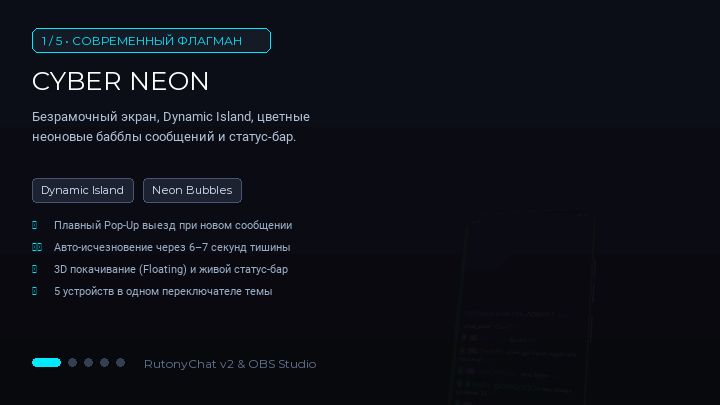
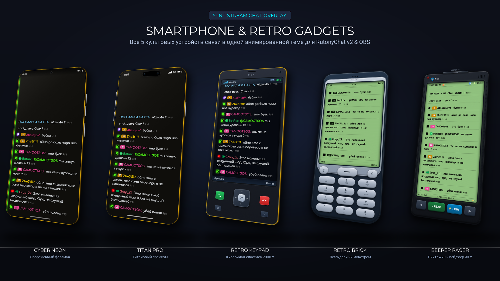
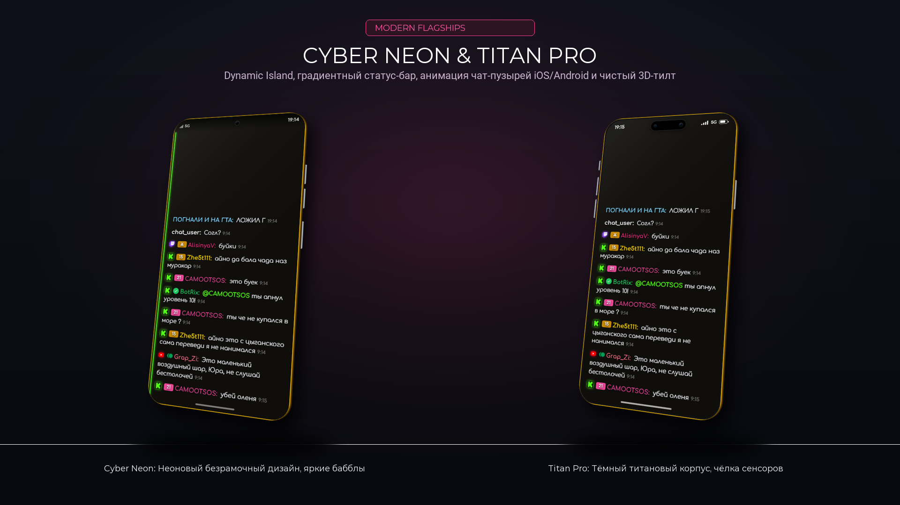
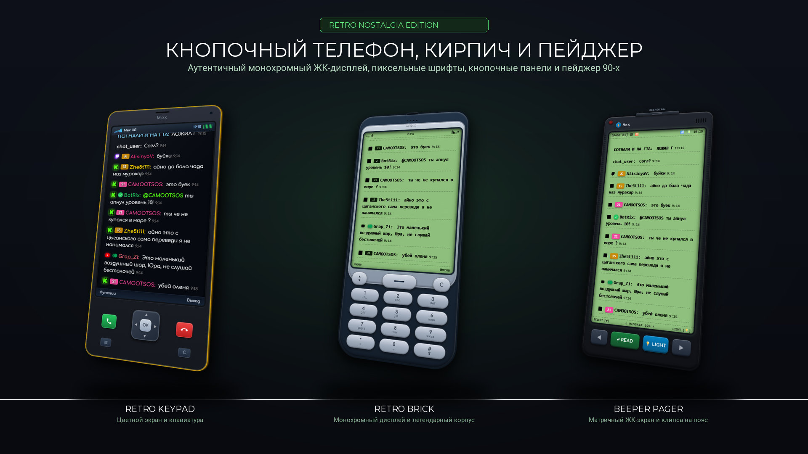
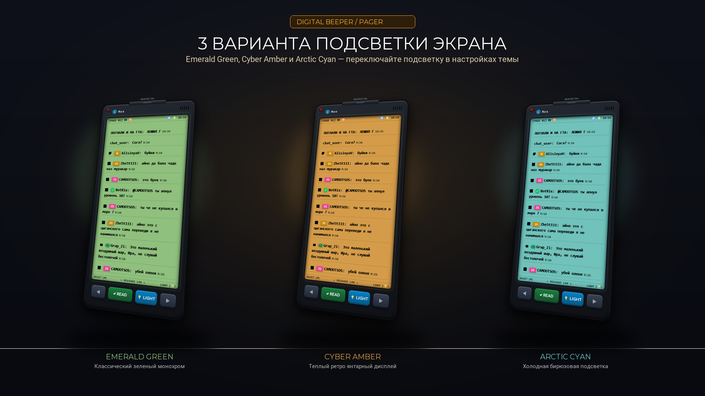
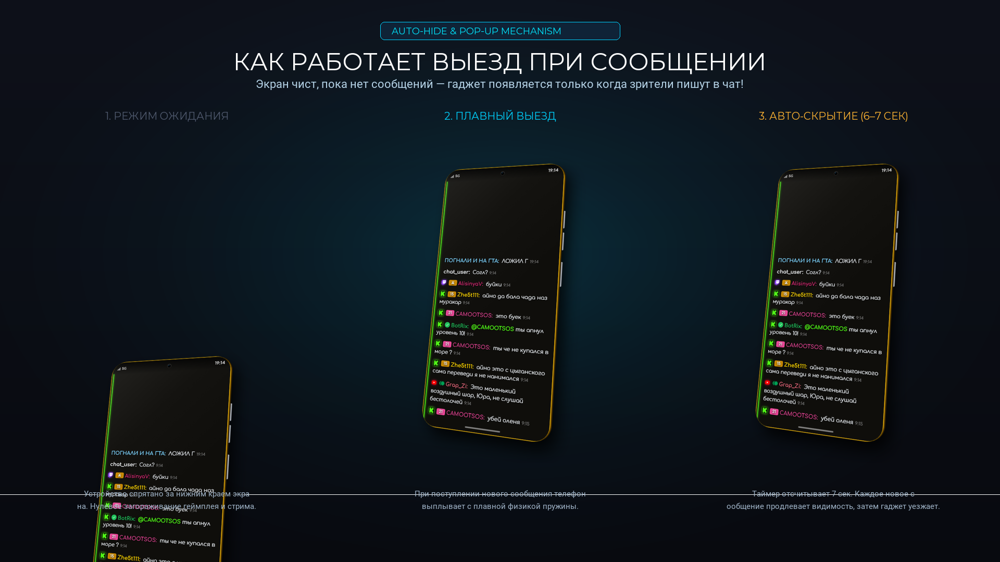
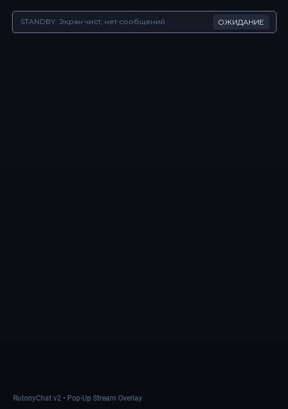

# 📱 Smartphone & Retro Gadgets — 5-in-1 Animated Pop-Up Overlay

  

  
  
  
  

---

## 🇷🇺 Описание темы (Russian)

**Smartphone & Retro Gadgets** — многослойная интерактивная тема чата для **RutonyChat v2** и **OBS Studio**, стилизованная под 5 культовых устройств связи разных эпох: современные флагманские смартфоны, кнопочный телефон 2000-х, монохромный неубиваемый «кирпич» и винтажный пейджер 90-х.

### 🌟 Ключевые возможности:
- **Умный Pop-Up механизм**: телефон или пейджер эффектно выплывает снизу при поступлении нового сообщения.
- **Авто-скрытие через 6–7 секунд**: при затишье в чате устройство аккуратно уезжает за экран, освобождая обзор стрима и игры. Каждое новое сообщение продлевает видимость.
- **Парящий 3D-Float**: легкое покачивание с микро-наклонами в перспективе (`rotateX`, `rotateY`, `translateY`).
- **5 моделей в одном переключателе**:
  1. `Cyber Neon` — современный безрамочный флагман с Dynamic Island и неоновыми чат-бабблами.
  2. `Titan Pro` — темный титановый корпус с сенсорной чёлкой и матовым стеклом.
  3. `Retro Keypad` — кнопочный мобильник 2000-х с клавиатурой, джойстиком и цветным Java-чатом.
  4. `Retro Brick` — легендарный монохромный «кирпич» с зеленым ЖК-экраном и пиксельным шрифтом.
  5. `Beeper / Pager` — ретро-пейджер 90-х с матричным дисплеем, защитным корпусом и клипсой.
- **Выбор подсветки монохромных дисплеев**: Emerald Green, Cyber Amber, Arctic Cyan.
- **Поддержка стриминговых платформ**: значки и аватары Twitch, YouTube, VK Play, Kick, Trovo, Discord, Telegram и др.

---

## 🇺🇸 Overview (English)

**Smartphone & Retro Gadgets** is an interactive, hardware-inspired stream chat overlay for **RutonyChat v2** and **OBS Studio**, featuring 5 iconic communication devices from different eras.

### 🌟 Key Features:
- **Smart Pop-Up on Message**: The device smoothly slides in from the bottom whenever a chat message arrives.
- **Auto-Retract Timer (6–7s)**: Automatically hides after 7 seconds of inactivity to keep your stream gameplay completely clean.
- **Continuous Reading**: New incoming messages instantly refresh the 7s countdown timer.
- **3D Floating Motion**: Natural floating/breathing hover with perspective tilt physics.
- **5 Devices Built-In**:
  1. `Cyber Neon`: Bezel-less modern flagship with Dynamic Island & glowing bubble chat.
  2. `Titan Pro`: Luxury titanium chassis with sensor notch & matte glass reflections.
  3. `Retro Keypad`: Mid-2000s classic mobile with physical keypad, D-pad, and vibrant Java UI.
  4. `Retro Brick`: Indestructible monochrome brick with emerald LCD, pixel fonts, and battery bars.
  5. `Beeper / Pager`: Authentic 90s pager with belt clip, dot-matrix display, and alert LED.

---

## 📸 Галерея скриншотов / Screenshots

  

  
  

  
  

---

## 🎬 Демонстрация Pop-Up механики / Pop-Up Demo

  

---

## ⚙️ Установка и настройка / Installation

### Через RutonyChat:
1. Скопируйте папку с темой в каталог `RutonyChat\themes\smartphone`.
2. В RutonyChat перейдите в **Настройки ➔ Темы оформления** и выберите **smartphone**.
3. Нажмите **«Настройка темы»**, чтобы настроить модель устройства, время скрытия и цвета.

### В OBS Studio:
1. Добавьте источник **Браузер (Browser Source)**.
2. Укажите локальный адрес `index.html` или URL из RutonyChat.
3. Рекомендуемые размеры источника в OBS:
   - **Ширина:** `480–540 px`
   - **Высота:** `750–850 px`
4. Включите опцию *«Завершать работу, если источник не отображается»*.

---

## 📄 Лицензия / License

Распространяется под свободной лицензией [MIT](LICENSE).
Разработано для стримеров и создателей контента!
